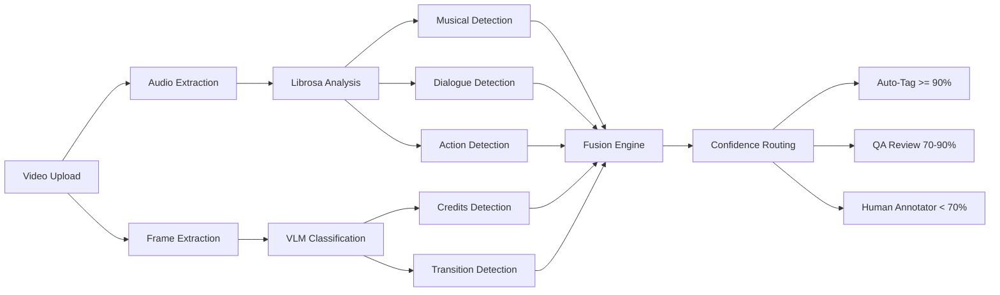

# JioTV+ Xtras — AI Video Content Classifier (Prototype)

A simplified, working proof-of-concept of the **JioTV+ Xtras** contextual overlay feature — an Amazon X-Ray-style experience that enriches passive video viewing with real-time AI-detected content metadata.

> **[Live Demo](https://jiotv-xtras-prototype-exo33ekezeaaycvdgdehse.streamlit.app)** · **[Case Study](https://akhil743.github.io/akhil-portfolio-website/portfolio/jiotv-xtras.html)**

---

## What is JioTV+ Xtras?

JioTV+ Xtras is a contextual AI overlay for JioTV+ that transforms passive streaming into active discovery. Think **Amazon X-Ray for Indian content** — while watching a movie, viewers get real-time information about what's on screen: whether a song sequence is playing, who's in the scene, when action peaks, and where the credits roll.

The production feature drove an **18% watch time increase** and unlocked an estimated **₹110 Cr+ annual value opportunity**.

## What This Prototype Demonstrates

This Streamlit app implements the **core detection pipeline** — the AI backbone that identifies content segments in video. It classifies video into:

| Category | Detection Method | Example |
|----------|-----------------|---------|
| **Musical** | Harmonic ratio, tempo, beat strength (librosa) | Song/dance sequences |
| **Dialogue** | Spectral centroids, zero-crossing rate, speech patterns | Conversation scenes |
| **Action** | High-energy transients, percussive ratio, RMS energy | Fight/chase sequences |
| **Credits** | Text detection, dark backgrounds (VLM) | Opening/closing credits |
| **Transition** | Landscape/establishing shots (VLM) | Scene transitions |

## Architecture



## Features

- **Three analysis modes**: Audio-only (librosa), VLM-only (Ollama vision models), and Hybrid (fused signals)
- **Color-coded timeline**: Visual segment map of the entire video
- **Confidence-based routing**: Auto-tag (>=90%), QA review (70-90%), human annotator (<70%)
- **Segment cards**: Detailed per-segment breakdown with confidence scores
- **Pre-cached demo**: Works out of the box with included sample results — no dependencies needed

## Quick Start

### Live Demo (Recommended)

Visit the **[Streamlit Cloud deployment](https://jiotv-xtras-prototype-exo33ekezeaaycvdgdehse.streamlit.app)** — check "Use pre-cached demo results" to see the classifier in action immediately.

### Run Locally

```bash
git clone https://github.com/Akhil743/jiotv-xtras-prototype.git
cd jiotv-xtras-prototype
pip install -r requirements.txt
streamlit run app.py
```

**For VLM mode** (optional — requires Ollama):
```bash
ollama serve
ollama pull moondream
```

### System Dependencies

- **ffmpeg** — required for video/audio processing (`brew install ffmpeg` on macOS)
- **Ollama** — optional, only needed for VLM and Hybrid modes

## Tech Stack

| Component | Technology |
|-----------|-----------|
| UI | Streamlit |
| Audio Analysis | librosa (spectral features, beat tracking, HPSS) |
| Vision Classification | Ollama (moondream, llava, bakllava) |
| Video Processing | ffmpeg / ffprobe |
| Signal Fusion | Confidence-weighted multi-modal merge |

## Project Structure

```
jiotv-xtras-prototype/
├── app.py                 # Streamlit UI — timeline, segment cards, metrics
├── audio_analyzer.py      # librosa-based audio classification
├── vlm_classifier.py      # Ollama VLM frame classification
├── video_processor.py     # ffmpeg/ffprobe video processing helpers
├── demo_results.json      # Pre-cached analysis results for demo mode
├── requirements.txt       # Python dependencies
├── packages.txt           # System dependencies (Streamlit Cloud)
└── .streamlit/
    └── config.toml        # Streamlit theme configuration
```

## How It Maps to JioTV+ Xtras

| Production Feature | This Prototype |
|-------------------|----------------|
| Real-time content overlay | Color-coded timeline + segment cards |
| Song/scene detection at scale | librosa audio analysis + VLM frame classification |
| Confidence-driven automation | Three-tier routing (auto-tag / QA / human) |
| Millions of hours of content | Single video upload + pre-cached demo |

This prototype demonstrates the **detection intelligence** layer. In production, this feeds into the overlay rendering engine, content metadata store, and real-time delivery pipeline.

---

**Built by [Akhil S](https://akhil743.github.io/akhil-portfolio-website/)** · AI Product Manager
